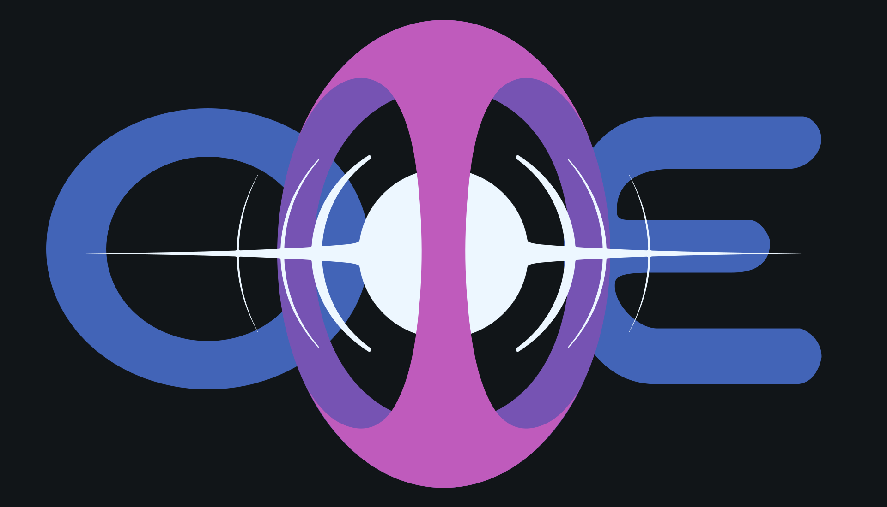

# Design

This folder records Open Music Event visual identity decisions and working design assets.

The approved reusable flat vector master lives in assets/ome-logo-master/. Earlier raster samples remain reference material for lighting and dimensional work.

Designer reference: [xcrunchy](https://www.xcrunchy.com/)

See [[logo|Logo]] for the detailed logo notes, references, constraints, and asset needs.

## Approved Flat Vector Master

Approved on 2026-10-21 after reviewing the O/E balance, cage proportions, solid portal silhouette, cage fit, and smooth connection to the circular core.

- [Layered master SVG](assets/ome-logo-master/OME-master.svg)
- [Dark preview](assets/ome-logo-master/preview.html)
- [Registered layers and sizing notes](assets/ome-logo-master/README.md)
- [Accepted dimensions and validation](assets/ome-logo-master/validation.json)

Use this as the source for reusable flat geometry. Every component shares the same 2000 x 2000 coordinate system; keep the front cage above the portal. Preview colors distinguish layers. The spectral/light direction below remains relevant for rendered applications.

Material-specific minimum features, kerf and cutter settings remain separate from the approved geometry. Existing app/site asset references and the user-authored Blender model are unchanged.

## Raster Lighting Reference

- `assets/ome-mark-sphere-cage-2026-07-13.png`
  - Full OME flat logo supplied on 2026-07-13.
  - Size: 2000 x 2000
  - Status: sphere-cage raster reference for spectral/light treatment; use the approved SVG master for flat geometry.

## Earlier Sample Assets

- `assets/ome-logo-sample-mark-2026-05.jpg`
  - Standalone portal/M sample copied from the current iOS app icon asset catalog.
  - Source at time of capture: `Darwin/Assets.xcassets/AppIcon.appiconset/OMEIconSample1.jpg`
  - Size: 1024 x 1024
  - Status: sample draft, not final canonical art.

- `assets/ome-logo-sample-wordmark-2026-05.jpg`
  - Full OME wordmark sample downloaded from the supplied Discord CDN image.
  - Size: 2000 x 2000
  - Status: sample draft, not final canonical art.

## Working Direction

- The center portal/M mark is the strongest identity element and should be explored as a motion and transition motif.
- The spectral/rainbow light treatment should behave like refraction, signal, or portal light rather than becoming the app's permanent accent color.
- The Blender model direction is a user-authored smoked-glass logo: a four-prong spherical cage around an inner white/cyan portal, with the front prong crossing in front.
- The dimensional logo should be nearly invisible on black until revealed by portal glow, grazing light, rim light, and subtle spectral accents.
- OME app chrome should stay calm, native, precise, and utilitarian.
- Event surfaces should be able to adopt each event's own palette, logo, and imagery.
- Liquid Glass on iOS can carry some refraction and depth in a few high-value places.
- The logo art should not be modified locally as part of product chrome work. Product work should consume final source assets once they are delivered.

## Related Roadmap Cards

- [[../roadmap/OME-049-visual-identity-tokens-and-chrome-rules|OME-049: Visual Identity Tokens and Chrome Rules]]
- [[../roadmap/OME-050-app-shell-chrome-refresh|OME-050: App Shell Chrome Refresh]]
- [[../roadmap/OME-051-event-theme-system|OME-051: Event Theme System]]
- [[../roadmap/OME-052-liquid-glass-portal-motion-system|OME-052: Liquid Glass Portal Motion System]]
- [[../roadmap/OME-053-layered-icon-and-asset-pipeline|OME-053: Layered Icon and Asset Pipeline]]
- [[../roadmap/OME-054-public-surface-and-qr-lockups|OME-054: Public Surface and QR Lockups]]

## Next Assets To Add

- Surface-specific exports from the approved layered vector master.
- Final app icon layers for iOS.
- Android adaptive icon foreground/background assets.
- Dark, light, and tinted variants.
