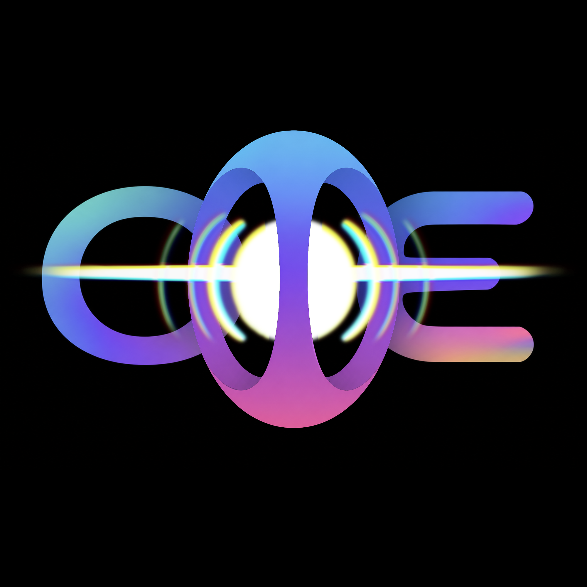
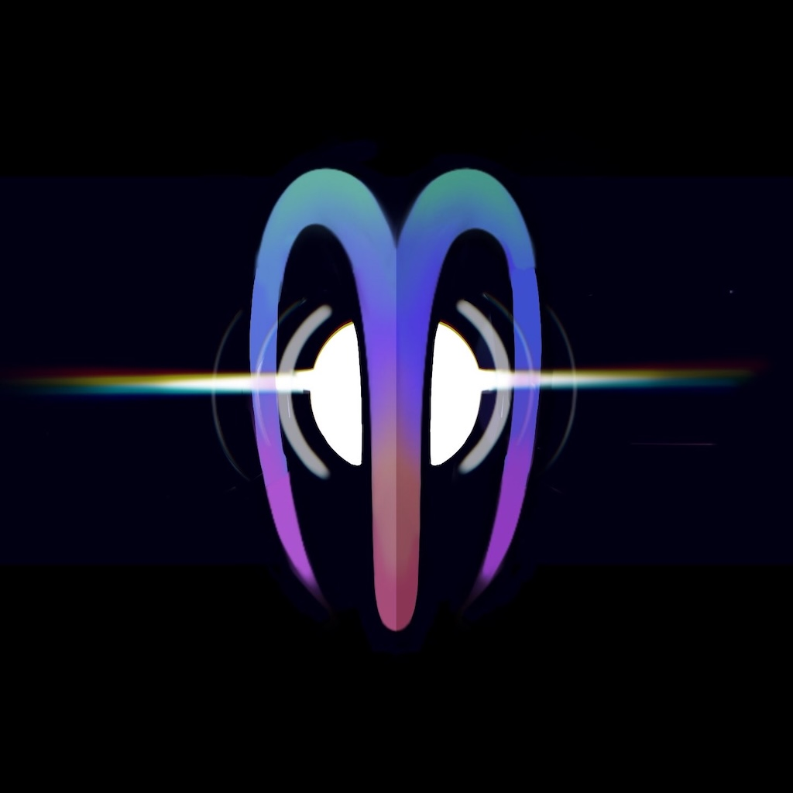
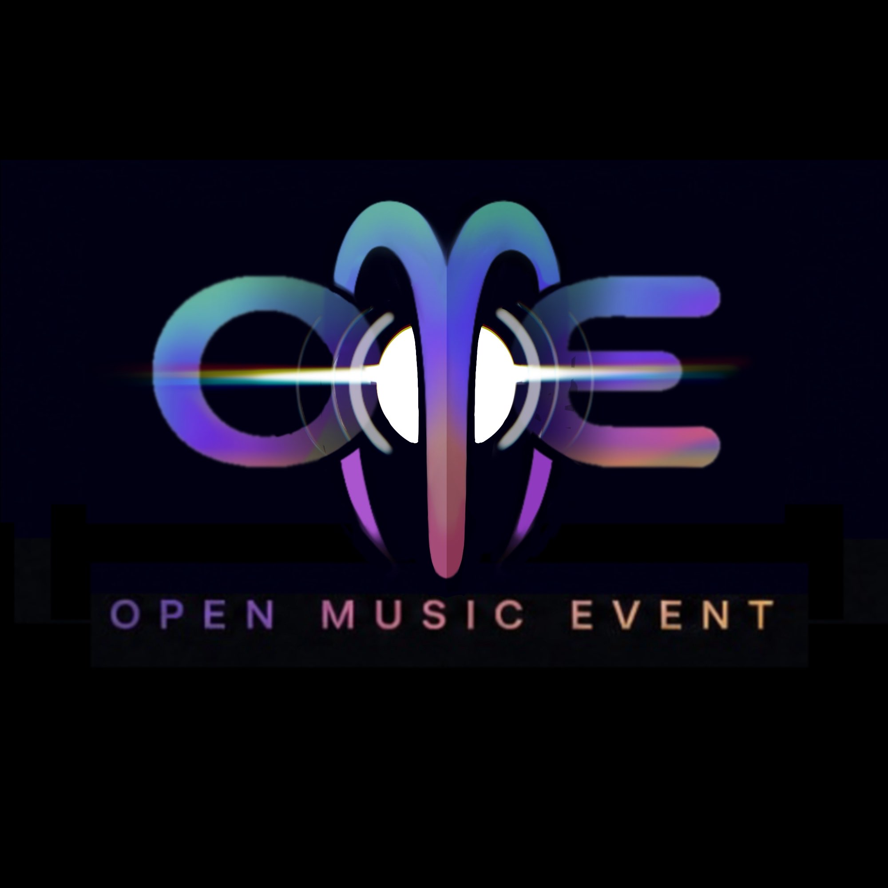

# Logo

This note tracks the working logo direction for Open Music Event.

These samples are close-to-final drafts, not canonical final artwork. Do not treat the current raster images as final source assets, and do not modify the artwork locally. Product and chrome work should consume final designer-provided assets when they are delivered.

Designer reference: [xcrunchy](https://www.xcrunchy.com/)

## Current Flat Logo Snapshot

- `assets/ome-mark-sphere-cage-2026-07-13.png`
  - Current flat logo snapshot for planning.
  - Size: 2000 x 2000.
  - Added from the supplied flat logo image on 2026-07-13.
  - Use as the current visual reference for static-site, app-icon, and motion-system planning.
  - Still need final layered source files before production asset slicing.

Visual features to preserve:

- Center portal/M shape as the primary standalone identity.
- Left `O` loop and right `E` beam lockup around the portal.
- Horizontal light beam crossing through the mark.
- Circular refraction rings around the portal.
- Spectral blue, violet, rose, and gold gradients over a black field.
- Wide-spaced `OPEN MUSIC EVENT` wordmark as a supporting lockup, not required for every app surface.

## Earlier Samples

- `assets/ome-logo-sample-mark-2026-05.jpg`
  - Standalone portal/M mark.
  - Size: 1024 x 1024.
  - Source at time of capture: `Darwin/Assets.xcassets/AppIcon.appiconset/OMEIconSample1.jpg`.
  - Use as an app-icon and motion-reference draft only.

- `assets/ome-logo-sample-wordmark-2026-05.jpg`
  - Full OME wordmark sample.
  - Size: 2000 x 2000.
  - Downloaded from the supplied Discord CDN image.
  - Use as a lockup and public-surface reference draft only.

## Original Brief

- Name: Open Music Event, abbreviated OME.
- The mark should be able to stand on its own as a symbol.
- It should feel recognizable, comfortable, and utilitarian.
- It should feel at home next to calendar and email on a home screen.
- It should also work beside QR codes, on digital surfaces, and on physical event objects or signage.
- It should be a solid foundation for richer graphics, not the whole visual system by itself.
- The product should feel closer to a trusty iPod than a flashy feed.

## Direction That Landed

- The center portal/M mark is the strongest part of the concept.
- The portal is useful beyond static branding: it can become the motion language for opening, loading, syncing, importing, and moving into an event context.
- The rainbow/spectral treatment works because it avoids locking OME to one brand color.
- Event surfaces can bring their own palettes, logos, posters, and visual identity.
- The OME chrome should stay calm and native around those event-specific visuals.
- The shape should lean precise rather than overly flowy.
- The mark should avoid becoming too music-specific, because the project may support conferences, comedy events, and other event categories later.

## Visual Identity Implications

- Treat spectral color as light, signal, or refraction rather than as the permanent OME accent color.
- Keep app shell chrome neutral and utility-oriented.
- Let event identity live primarily in event headers, rows, schedule accents, stage chips, badges, and public surfaces.
- Use the portal motif sparingly in high-value moments instead of repeating the logo everywhere.
- Preserve the option for OME to expand beyond the literal "Music" category.

## Motion And Liquid Glass

The logo folds naturally into iOS Liquid Glass because the portal, beam, and rings can read as refraction rather than decoration.

Good places for portal/refraction behavior:

- App launch or first load.
- Opening an event.
- Source import or sync progress.
- Auth handoff.
- QR scanning and event entry.
- Empty/loading/offline states.
- Later: optional audio-reactive or schedule-reactive motion.

Constraints:

- Prefer system glass/material effects where they carry the idea.
- Keep custom motion small and reusable.
- Include reduced-motion and reduced-transparency fallbacks.
- Avoid making the everyday UI feel like a neon theme.

## TouchDesigner Motion Planning

Start with TouchDesigner as a small external motion lab, not the app implementation. The goal is to learn the motion language from the final mark, then translate only the useful pieces into app-native animation later.

Expect a 3D model to be part of this system, likely authored in Blender. Blender should be the source for any dimensional logo geometry, materials, camera moves, and model cleanup; TouchDesigner can then ingest the model or rendered passes for procedural motion, compositing, audio-reactive experiments, and export studies.

Small prototype shape:

- Build the mark as separated layers: portal/M matte, `O` and `E` forms, beam, refraction rings, gradient pass, glow/bloom, and wordmark.
- Build or request a rough Blender model with separated portal/M geometry, side letterforms, beam volume, refraction rings, and optional wordmark geometry.
- Make one short loop or state transition first: beam wakes up, portal opens, rings pulse once, spectral color breathes, then the mark resolves to stillness.
- Keep parameters explicit: beam intensity, ring radius, ring decay, gradient phase, portal aperture, blur, bloom, and final hold time.
- Treat audio-reactive behavior as optional exploration, not a requirement for the first pass.
- Export reference clips and still frames for review; keep notes on the model, material, camera, and parameter values that feel reusable.
- Later app translation can be SwiftUI/Liquid Glass first, with custom rendering only where the system materials cannot carry the effect.

Open questions:

- Is TouchDesigner only a sketching tool, or should it also render event-specific visual assets?
- Is Blender the canonical 3D asset source, or only a rough model for motion exploration?
- Who owns the first Blender model: designer-provided layered/source artwork, or an internal rough rebuild for prototyping?
- Which single app moment should inherit the first motion idea: launch, event open, import/sync, auth handoff, or QR entry?
- Should the portal react to real audio or schedule state later, or stay purely state-driven?

## Blender Model Direction

The current Blender direction treats the final mark as dimensional glass and light, not as a flat logo extrusion. The model work is user-authored in Blender 5.1.2; do not treat any AI-generated starter script as the source of truth.

Settled shape direction:

- The center mark is a four-prong spherical claw or cage around an inner portal.
- The front prong crosses in front of the portal core.
- The portal is the glowing object inside the cage, not a cutout or aperture in the front surface.
- The `O` and `E` are supporting smoked-glass side forms around the cage.
- The bottom `OPEN MUSIC EVENT` wordmark is a supporting lockup and can use the same glass/light language, but it should stay quieter than the portal.

Material and lighting direction:

- The logo geometry should be able to go nearly invisible against a black field.
- Legibility should come from grazing light, rim light, portal glow, and spectral reflections rather than bright base colors.
- Use dark smoked glass for the `O`, `E`, cage, and wordmark body.
- Use the portal core as a white/cyan light source inside the cage.
- Add spectral color through lighting and reflections: cyan/blue rim, violet rim, and subtle rose/gold accent.
- Keep the background dark and restrained so the mark appears when light reveals it.
- Render noise from glass/transparent materials is expected during preview; final stills should use higher samples and denoise.

Useful lighting roles:

- Portal light: inside the cage; white/cyan; reveals the inner cage and front-prong silhouette.
- Rim lights: behind or side-grazing; blue, cyan, or violet; reveal the outside contours of the `O`, cage, and `E`.
- Warm accent: low and subtle; rose or gold; preserves the spectral mark without turning the UI into a neon theme.
- Wordmark light: low, glancing, or duplicated as a faint emission layer so the letters can appear from darkness without becoming flat white text.

Automation and handoff:

- Keep major objects separate and named for later TouchDesigner control.
- Likely animation handles: portal intensity, front-prong silhouette, cage rotation or opening, O/E shimmer, beam intensity, ring pulse, gradient phase, bloom, and audio-reactive experiments.
- Blender should carry the authored geometry and material look; TouchDesigner should make the logo come alive through automation and compositing.

## Asset Needs

- Final layered source artwork.
- Blender model or source geometry for the dimensional mark.
- Standalone mark.
- Full wordmark.
- App icon layers for iOS.
- Android adaptive icon foreground/background assets.
- Dark, light, tinted, and monochrome survival variants.
- QR-adjacent lockups.
- "Powered by Open Music Event" style lockups.

## Related Roadmap Cards

- [[../roadmap/OME-049-visual-identity-tokens-and-chrome-rules|OME-049: Visual Identity Tokens and Chrome Rules]]
- [[../roadmap/OME-050-app-shell-chrome-refresh|OME-050: App Shell Chrome Refresh]]
- [[../roadmap/OME-051-event-theme-system|OME-051: Event Theme System]]
- [[../roadmap/OME-052-liquid-glass-portal-motion-system|OME-052: Liquid Glass Portal Motion System]]
- [[../roadmap/OME-053-layered-icon-and-asset-pipeline|OME-053: Layered Icon and Asset Pipeline]]
- [[../roadmap/OME-054-public-surface-and-qr-lockups|OME-054: Public Surface and QR Lockups]]
